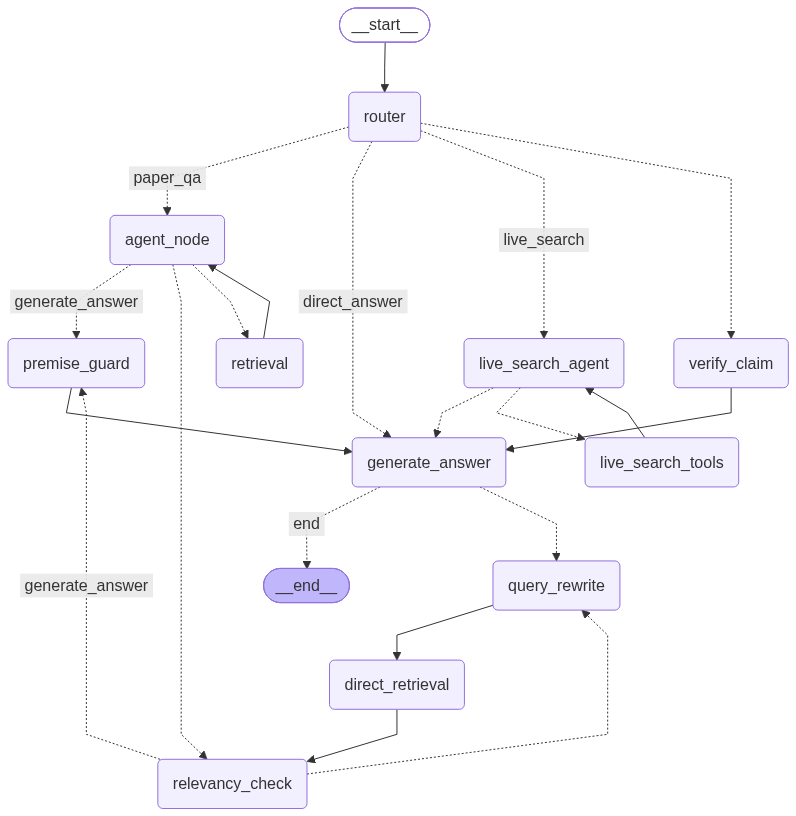

# Papeer — Agentic Research Paper Assistant

Upload research papers and get grounded, cited answers. Papeer is a full-stack RAG application: a Next.js web app with Neon Auth, a FastAPI backend, and a LangGraph retrieval pipeline over Qdrant Cloud.

---

## What it does

- Upload PDFs, TXT/MD files, web pages, or arXiv papers into isolated sessions
- Ask questions and get answers grounded in the paper, with page citations
- Figures are extracted during ingestion and shown inline in answers
- Streaming answers over SSE, with a critic pass that blocks ungrounded claims
- False-premise questions are corrected from retrieved text instead of answered blindly
- Web search and claim verification for "is this still true?" questions
- Multi-session history, auto-naming, and per-user libraries

---

## Architecture

```
Browser — Next.js 16 / React 19 (Neon Auth)
   │  /api/chat/stream  (SSE proxy, X-API-Key)
   ▼
FastAPI — api/
   │  /chat, /chat/stream, /papers/*, /btw
   ▼
LangGraph — backend/rag_graph.py
   │  router → premise guard → hybrid retrieve → relevancy → generate → critic
   ▼
Qdrant Cloud (dense + BM25, reranked chunks)
Neon Postgres (embedding cache, LangGraph checkpoints)
Gemini embeddings (gemini-embedding-2, 1536 dims)
```



*LangGraph routing: `router` sends each question to paper QA, live search, claim verification, or a direct answer. Paper QA runs `premise_guard` → hybrid retrieval → `generate_answer`; `relevancy_check` rewrites the query up to 3 times, and a refusal after generation triggers one more rewrite. Dotted edges are conditional. The critic gate and SSE streaming are runtime layers around this graph, not graph nodes.*

| Layer | Stack |
|---|---|
| Web | Next.js 16, React 19, TypeScript, Neon Auth |
| API | FastAPI, Uvicorn, SSE |
| RAG | LangGraph, LangChain, gpt-4o-mini (temperature 0) |
| Retrieval | Qdrant Cloud, hybrid dense + BM25 + FlashRank rerank |
| Storage | Neon Postgres (cache + checkpoints), local blob store for figures |
| Eval | DeepEval (5 metrics), synthetic goldens |

---

## Project structure

```
api/                 FastAPI app, routers, auth, rate limiting
backend/             RAG graph, vector store, ingestion, figures, streaming, timing
web/                 Next.js app (chat UI, upload, auth, API proxies)
tests/               pytest suite
evaluate.py          DeepEval multi-document harness
Dockerfile           Python image (FastAPI backend)
web/Dockerfile       Next.js image
DOCKER_GUIDE.md      Build, push, and EC2 deployment
documents/           Local PDFs for evaluation (gitignored)
```

---

## Quick start

### Backend

```bash
uv sync
cp .env.example .env        # fill in the keys listed below
uv run --no-sync uvicorn api.main:app --host 0.0.0.0 --port 8000
```

Health check: `curl http://localhost:8000/health`

### Web

```bash
cd web
npm install
cp .env.local.example .env.local
npm run dev
```

Open http://localhost:3000.

---

## Environment variables

### Backend (`.env`)

| Variable | Purpose |
|---|---|
| `OPENAI_API_KEY` | Answer generation and LLM judge (`gpt-4o-mini`) |
| `GOOGLE_API_KEY` | Embeddings (`gemini-embedding-2`, 1536 dims) |
| `QDRANT_URL`, `QDRANT_API_KEY` | Vector store |
| `DATABASE_URL` | Neon Postgres for embedding cache + checkpoints |
| `PAPEER_API_KEY` | Shared key clients send as `X-API-Key` |
| `TAVILY_API_KEY` | Web search and claim verification |
| `XKIRO_API_KEY` | Optional LLM fallback when `OPENAI_API_KEY` is unset |

### Web (`web/.env.local`)

| Variable | Purpose |
|---|---|
| `NEXT_PUBLIC_API_URL` | Backend URL (inlined at build time) |
| `PAPEER_API_KEY` | Sent to the backend as `X-API-Key` |
| `NEON_AUTH_BASE_URL` | Neon Auth endpoint (server-side) |
| `NEON_AUTH_COOKIE_SECRET` | Session cookie signing secret (32+ chars) |
| `NEXT_PUBLIC_NEON_AUTH_URL` | Neon Auth URL used by the browser |

---

## API

| Method | Path | Purpose |
|---|---|---|
| `GET` | `/health` | Liveness |
| `POST` | `/chat` | Ask a question |
| `POST` | `/chat/stream` | Ask a question, stream tokens (SSE) |
| `POST` | `/chat/rename` | Auto-name a session |
| `GET` | `/chat/{session_id}/history` | Conversation history |
| `POST` | `/papers/upload` | Upload PDF/TXT/MD |
| `POST` | `/papers/arxiv` | Load from arXiv |
| `POST` | `/papers/webpage` | Load from URL |
| `POST` | `/papers/sessions` | Create a session |
| `GET` | `/papers/{session_id}` | List papers |
| `GET` | `/papers/{session_id}/status` | Ingestion status |
| `GET` | `/papers/{session_id}/figures/{figure_id}` | Figure image |
| `DELETE` | `/papers/{session_id}` | Delete a session |
| `DELETE` | `/papers/{session_id}/papers` | Delete a paper |
| `POST` | `/btw` | Off-topic side channel (not stored) |

---

## How the project is production optimized

| Optimization | Details |
|---|---|
| **SSE streaming** | `/chat/stream` streams tokens with `X-Accel-Buffering: no`; a closed stream stops sending tokens (the turn may still be saved) |
| **Critic gate** | A lexical-grounding heuristic decides when to buffer and re-check an answer before it reaches the user |
| **Refusal handling** | Stray "the paper does not state this" sentences are stripped; pure refusals are preserved |
| **Premise guard** | Deterministic check corrects false-premise questions using retrieved text, not hardcoded answers |
| **Embedding cache** | Identical text is never re-embedded; cached in Neon Postgres with a local fallback |
| **Retrieval caching** | Collection handle and session-document scroll are memoized; first-query latency dropped from 31.7 s to 7.3 s |
| **Figure pipeline** | Figures are extracted at ingest time, stored as blobs, and served through a proxy route |
| **Timing instrumentation** | `PAPEER_TIMING=1` prints per-node timings for the whole graph |

---

## Constraints and why

| Constraint | Why |
|---|---|
| **Max 3 query rewrites** | Prevents unanswerable questions from looping and burning tokens |
| **Chunk size 1000 / overlap 200** | Balances precision against context preserved across boundaries |
| **`k=4` retrieved chunks** | Enough context without diluting the prompt or increasing cost |
| **Session-scoped collections** | Prevents papers from one session leaking into another |
| **Temperature 0** | Deterministic answers and a stable evaluation baseline |
| **Critic only when risky** | Running the critic on every answer doubles latency for no gain on well-grounded text |

---

## Evaluation

`evaluate.py` runs a DeepEval harness over hand-labelled questions and writes per-question results to `eval_results_v4.json` (gitignored).

### Setup

- **Corpus:** 2 papers in `documents/` (PDFs are gitignored): the Transformer paper and a technical report.
- **Goldens:** `goldens_manual_pairs.json`, 25 hand-written question/answer pairs with the source page (10 per paper, plus 5 questions about the figures in the Transformer paper).
- **Generator and judge:** `gpt-4o-mini` (temperature 0). Retrieval uses Gemini embeddings.
- **Metrics (threshold 0.7):** Contextual Precision, Contextual Recall, Contextual Relevancy, Answer Relevancy, Faithfulness.

### Results

Same 20 text questions after each change (single run each):

| Stage | Ctx Precision | Ctx Recall | Ctx Relevancy | Ans Relevancy | Faithfulness | Gold page retrieved |
|---|---|---|---|---|---|---|
| Parent-child chunks, query variants + BM25 rescue | 0.68 | 0.58 | 0.29 | 0.86 | 0.89 * | 9/20 |
| Plain 1000-character chunks | 0.67 | 0.71 | 0.25 | 0.86 | 0.90 * | 10/20 |
| Hybrid search + rerank, top 5, relative score cutoff | 0.88 | 0.95 | 0.39 | 0.94 | 0.77 | 19/20 |
| + Docling for table pages | 0.89 | 0.98 | 0.44 | 0.92 | 0.86 | not measured |

\* The first two rows include 4 refusals ("the paper does not state this"), which always count as faithful. The new retrieval answers all 20, so its Faithfulness is the honest figure.

Figure questions (5, evaluated separately, with figure chunks indexed):

| Setup | Ctx Precision | Ctx Recall | Faithfulness |
|---|---|---|---|
| Caption text only | 0.67 | 0.64 | 0.73 |
| + `gpt-4o` figure descriptions at ingestion | 0.81 | 0.72 | 0.77 |

### Limitations

- 20 text questions and 5 figure questions is a small sample. Run-to-run noise is about 0.05, so treat differences below that as noise.
- Contextual Relevancy scores every context sentence on its own; it stayed below 0.5 and no question passed 0.7. It is useful as a direction, not as a target.
- Generator and judge are the same model family.
- The Docling run was evaluated in a local environment, not inside the Docker image.
- Figure 2's left diagram (MatMul, Scale, Mask, SoftMax) is still read wrongly by the vision models tried.

### Running the evaluation

```bash
# add the two PDFs to documents/, then:
uv run python evaluate.py

# optional: table extraction with Docling
uv run --extra docling python evaluate.py

# optional: figure descriptions
PAPEER_FIGURE_DESCRIPTIONS=1 PAPEER_VISION_MODEL=gpt-4o uv run python evaluate.py
```

Retrieval settings are in `.env.example` (`PAPEER_PRIMARY_K`, `PAPEER_REL_CUTOFF`, `PAPEER_DOCLING`).

---

## Earlier evaluation (v3)

Papeer includes an automated multi-document RAG evaluation harness (`evaluate.py`) built on [DeepEval](https://github.com/confident-ai/deepeval).

### Setup

- **Corpus:** 4 research papers (68 pages) placed in `documents/` (PDFs are gitignored)
- **Goldens:** 35 LLM-synthesized Q/A pairs, filtered for grounding, entities, numbers, duplicates, and bibliography noise (not human-labeled)
- **Judge:** `gpt-4o-mini` at temperature 0; OpenAI `text-embedding-3-small` for grounding checks only (retrieval keeps Gemini embeddings)

### Metrics (threshold: 0.7)

| Metric | What It Measures |
|---|---|
| **Contextual Precision** | Are the retrieved chunks relevant to the query? |
| **Contextual Recall** | Does the retrieved context cover all expected information? |
| **Contextual Relevancy** | Is the context relevant to both the input and the expected output? |
| **Answer Relevancy** | Does the generated answer actually address the question? |
| **Faithfulness** | Is the answer grounded in the retrieved context (no hallucination)? |

### Results (v3, 4 documents / 35 goldens)

| Document | Ctx Precision | Ctx Recall | Ctx Relevancy | Ans Relevancy | Faithfulness |
|---|---|---|---|---|---|
| 2212.10496v1 (8) | 0.90 (7/8) | 0.94 (8/8) | 0.47 (2/8) | 0.89 (6/8) | 0.81 (5/8) |
| NIPS Attention (10) | 0.98 (10/10) | 0.93 (9/10) | 0.34 (0/10) | 0.93 (9/10) | 0.93 (9/10) |
| Openclaw Report (9) | 0.91 (8/9) | 0.87 (7/9) | 0.46 (1/9) | 0.97 (9/9) | 0.94 (8/9) |
| Springer MOCAA* (8) | 0.95 (8/8) | 0.69 (5/8) | 0.53 (2/8) | 0.80 (6/8) | 0.94 (8/8) |
| **Overall (35)** | **0.94 (33/35)** | **0.86 (29/35)** | **0.45 (5/35)** | **0.90 (30/35)** | **0.91 (30/35)** |

Change from the v2 baseline (40 goldens, different document set): Contextual Precision **0.87 → 0.94**, Contextual Recall **0.75 → 0.86**, Answer Relevancy **0.78 → 0.90**, Faithfulness **0.89 → 0.91**, Contextual Relevancy **0.44 → 0.45**.

### Reading the numbers

- **Generation is solid:** 0.94 precision and 0.90 answer relevancy; the NIPS paper reaches 0.98 precision and Openclaw 0.97 answer relevancy.
- **Contextual Relevancy (0.45) is the retrieval bottleneck**, not the answer path. NIPS scores 0.34 because retrieved child chunks often contain surrounding sections; this is the next optimization target.
- **Springer's 0.69 recall is mostly a measurement artifact:** DeepEval scores child chunks while the generator answers from expanded parent chunks, so facts present in the parent but absent from the child count as misses. Three of the six low-recall cases are this pattern; one was a bad golden synthesized from a reference list (fixed by bibliography-tail stripping).
- Goldens for 2212/Openclaw/Springer had 1–2 shortfalls (8–9 of 10); NIPS reached 10/10.

### Running evaluation

```bash
# add PDFs to documents/, then:
uv run python evaluate.py
```

- Goldens are generated per document and cached in `goldens_v3.json`; the cache is keyed by file hash + filter settings
- Results are written to `eval_results_v3.json` after each document, so partial runs survive interruption
- Raw results, goldens, and diagnostics are gitignored; this table is the committed record

---

## Tests

```bash
uv run pytest
```

Covers the critic gate, refusal stripping, SSE streaming, and figure extraction.

---

## Deployment

See [DOCKER_GUIDE.md](DOCKER_GUIDE.md) for building the images, pushing to Docker Hub, and running the web container plus backend on EC2.
